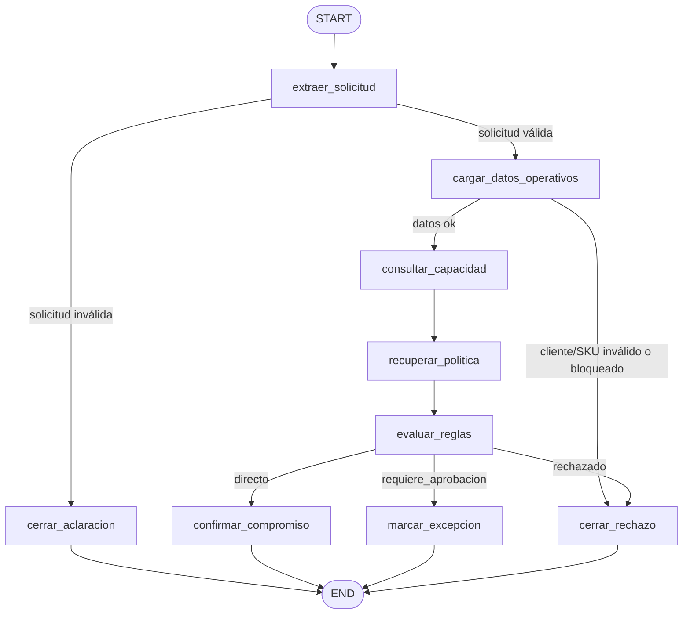

# Workflow con estado — Caso LOG-001 (Semilla 6739)

El workflow orquesta el compromiso de entrega B2B con LangGraph. Las decisiones
de negocio las toman las reglas deterministas de `reglas.py`; el LLM solo se usa
para estructurar la solicitud en lenguaje natural (y es inyectable, por lo que el
grafo completo funciona offline con entrada estructurada).

## Diagrama del grafo



## Responsabilidad de cada nodo

| Nodo | Responsabilidad | Fuente que aporta |
|---|---|---|
| `extraer_solicitud` | Estructura y valida la solicitud (`SolicitudLogistica`); sin extractor LLM acepta entrada estructurada | — |
| `cargar_datos_operativos` | Verifica cliente activo y stock del SKU | `[SQL:clientes]`, `[SQL:inventario]` |
| `consultar_capacidad` | Capacidad normal/extraordinaria de la fecha pedida | `[SQL:reservas_capacidad]` |
| `recuperar_politica` | Adjunta políticas citables; sin API degrada con advertencia y las reglas deciden | `[RAG:...]` |
| `evaluar_reglas` | Aplica `evaluar_compromiso` con los datos recopilados | — |
| `confirmar_compromiso` | Cierra la ruta directa con confirmación trazable | — |
| `marcar_excepcion` | Deja la excepción `pendiente_aprobacion` (HITL en Hito 04) | — |
| `cerrar_rechazo` | Cierra con el motivo de negocio, sin retry | — |
| `cerrar_aclaracion` | Pide los datos faltantes sin ejecutar tools | — |

## Campos del estado (`EstadoLogistico`)

| Campo | Contenido | Por qué está |
|---|---|---|
| `caso_id`, `semilla` | `LOG-001`, `6739` | Trazabilidad del escenario reproducible |
| `id_solicitud` | Identificador de la ejecución (`--id-hilo`) | Auditoría y, en Hito 04, hilo del checkpoint |
| `solicitud_original` | Texto o descripción de entrada | Evidencia de qué pidió el usuario |
| `solicitud` | `SolicitudLogistica` serializada | Entrada validada de las reglas |
| `cliente` | Fila del cliente consultado | Sustento de la decisión |
| `stock_disponible` | Unidades disponibles del SKU | Sustento de la decisión |
| `capacidad` | Resultado de capacidad de despacho | Sustento de la decisión |
| `evaluacion` | Resultado serializado de las reglas | Decisión trazable |
| `fuentes` | Lista acumulativa de `source_ref` | Citas verificables (reductor aditivo) |
| `aprobacion` | Marcador HITL (`requerida`, `rol`, `decision`) | Lo completa el Hito 04 |
| `estado` | `procesando`/`aclaracion`/`confirmado`/`pendiente_aprobacion`/`rechazado` | Resultado del proceso |
| `mensaje` | Texto final para el usuario | Salida legible |

El estado **no** guarda claves, conexiones, historial conversacional ni
documentos crudos: solo lo necesario para decidir y auditar.

## ¿Por qué un grafo con estado y no una cadena `if/else`?

1. **Ramas de negocio reales**: directo, excepción pendiente, rechazo y
   aclaración conviven con salidas anticipadas (cliente bloqueado, SKU
   inexistente). Un `if/else` lineal esconde esas rutas; el grafo las hace
   explícitas y dibujables.
2. **Estado auditable**: cada nodo agrega hechos y fuentes a un estado tipado;
   al final se puede responder *por qué* se decidió, no solo *qué* se decidió.
3. **Puntos de extensión del curso**: retry, checkpoint e `interrupt()` HITL
   (Hito 04) y exposición como servidor MCP (Hito 05) se enchufan al grafo sin
   reescribir la lógica.
4. **Dependencias inyectables**: extractor LLM, embedder y base de datos se
   inyectan en `build_workflow`, así los tests corren offline y deterministas.

## Ejecución

```bash
# Offline, entrada estructurada (sin API)
uv run python -m agente_logistico --cliente C-1003 --sku EDGE-ORIN \
  --cantidad 6 --fecha 2026-03-19 --id-hilo demo-directo --offline

# Lenguaje natural (requiere OPENAI_API_KEY en .env)
uv run python -m agente_logistico --id-hilo demo-llm \
  --solicitud "Andes Manufactura (C-1003) necesita 6 EDGE-ORIN para el 2026-03-19"
```
